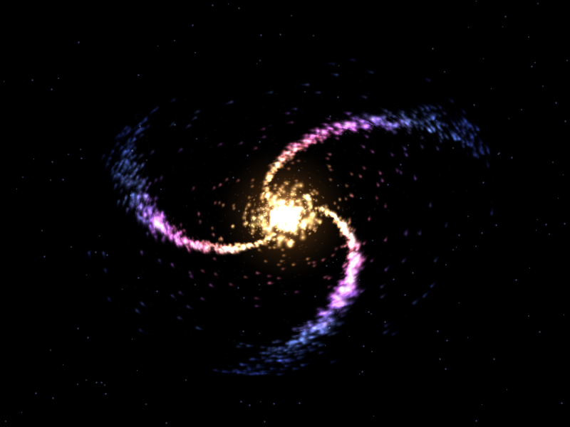

# 星河轨道 · Stellar Orbit

纯 Python + Pygame 的螺旋星系粒子动画，运行即自动播放，无任何交互，关窗即退出。



（`galaxy_preview.mp4` 是程序无窗口渲染的 4 秒片段，800×600 / 60fps。）

## 安装

```bash
pip install pygame
```

Python 3.15 目前没有 pygame 官方轮子，可改用社区版：`pip install pygame-ce`（`import pygame` 不变）。

## 运行

```bash
python galaxy_orbit.py
```

关闭窗口或按 `ESC` 退出。全屏把开头 `FULLSCREEN = True`。

## 可调参数

全部在文件顶部「可配置参数」区：

| 参数 | 含义 |
| --- | --- |
| `PARTICLE_COUNT` | 粒子总数（默认 4800） |
| `ARM_COUNT` / `ARM_TWIST` / `ARM_SPREAD` | 旋臂数量 / 缠绕弧度 / 旋臂宽度 |
| `ROTATION_SPEED` | 星系整体角速度（弧度/秒） |
| `TRAIL_DECAY` / `TRAIL_FLOOR` | 拖尾衰减强度 / 底噪裁剪 |
| `DISK_TILT_DEG` / `DISK_ROLL_DEG` | 盘面倾角与滚转 |
| `CORE_PULSE_SPEED` / `CORE_PULSE_AMOUNT` | 核心呼吸频率与幅度 |
| `PALETTE_STOPS` | 中心金黄 → 外围粉/紫/蓝的渐变色板 |

## 实现要点

- 对数螺旋撒点生成 3 条旋臂，另混入核球星团与压暗的弥散星；所有粒子共用同一角速度，旋臂永不拧散。
- 颜色 × 尺寸 × 亮度共 896 张辉光贴图启动时预烘焙，每帧只做 blit；800×600 实测约 4.5 ms/帧（≈220 fps 余量）。
- 独立拖尾画布：每帧先乘 0.82 再减 2，既有光轨，又不会让整盘糊成灰雾版画。
- 核心为三层金/白辉光叠加，半径正弦脉动；单独画在屏幕上，避免加法累积过曝。

## 自检

```bash
python galaxy_orbit.py --selftest --frames 300 --shot out.png
```

无窗口跑 300 帧，打印平均每帧耗时并截图。
